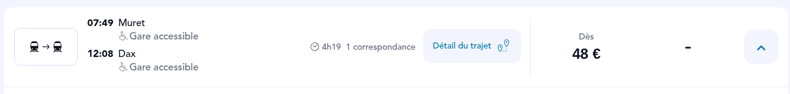
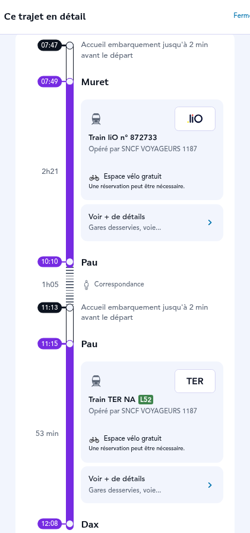
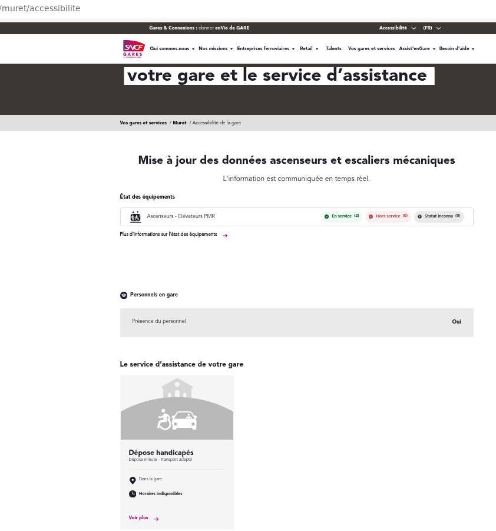
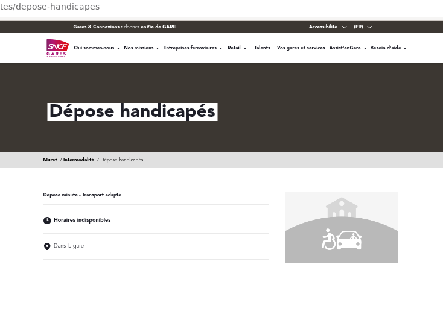
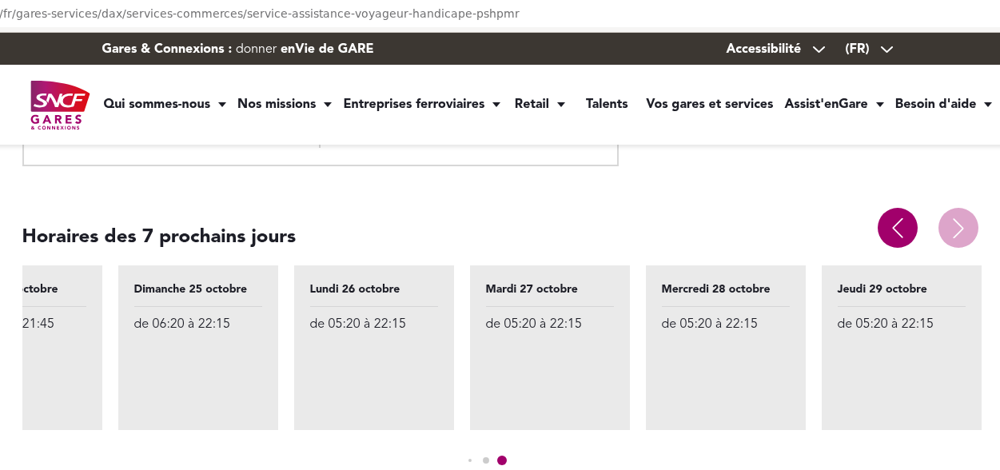
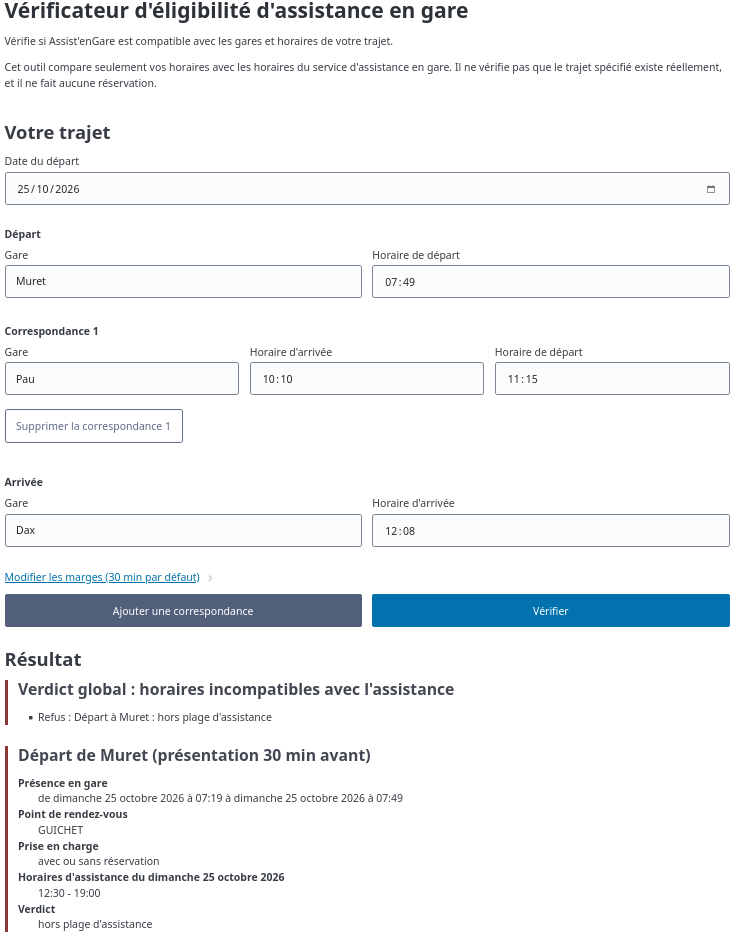

# AssistVerif

Un petit outil pour vérifier si les horaires d'un trajet en train tombent bien dans les horaires d'assistance en gare (Assist'enGare).

Le site : https://klemmm.github.io/assistverif/

## Pourquoi

J'ai fait cet outil après avoir réservé des billets pour ma mère, qui a besoin d'assistance en gare. Sur SNCF Connect, même avec l'option PMR, le trajet était affiché « Gare accessible ». En fait, l'assistance n'était pas ouverte à l'heure du départ.

Le trajet en question, un Muret → Dax un dimanche avec départ à 07:49 :

Le dimanche, l'assistance à Muret n'ouvre qu'à 12h30. C'est ce qu'indiquent les données ouvertes de la SNCF, et le 32 12 me l'a confirmé au téléphone.

J'ai voulu vérifier sur le site de Gares & Connexions, et j'ai vu que pour certaines gares, l'information n'est pas dipsonible. Par exemple, pour Muret, la page n'affiche aucun horaire d'assistance. La seule chose listée, c'est la dépose minute, avec « Horaires indisponibles » :

Pour les gares où les horaires sont affichés, on ne voit que les 7 prochains jours, et comme l'horaire varie pour les jours feriés, dans le cas d'un trajet réservé plus d'une semaine a l'avance et tombant sur un jour ferié, le site ne permet donc pas d'avoir l'information.

Aussi, pour certaines gares, le site et les données ouvertes ne donnent pas les mêmes horaires. À Dax, en octobre 2026 :

| | Site Gares & Connexions | Données ouvertes |
|---|---|---|
| Samedi | 06:20 – 21:45 | 06:30 – 23:15 |
| Dimanche | 06:20 – 22:15 | 06:30 – 22:25 |
| Lundi à jeudi | 05:20 – 22:15 | 05:20 – 22:25 |

Je ne sais pas laquelle des deux sources est la bonne. Pour Muret, c'étaient les données ouvertes. Et les lieux de rendez-vous indiqués dans la confirmation de réservation Assist'enGare sont exactement ceux des données ouvertes, fautes de frappe comprises. Je pense donc qu'elles viennent du même système que les réservations, mais je n'en ai pas la preuve.

Les données sont publiques, donc j'ai fait l'outil. Sur le même trajet, il voit le problème tout de suite :

## Ce qu'il fait (et ne fait pas)

On entre la date, les gares et les horaires (départ, correspondances, arrivée). Pour chaque gare, l'outil vérifie que l'assistance est ouverte pendant tout le temps où on y est : à partir de 30 minutes avant le départ (réglable), pendant toute la correspondance, et à l'arrivée. Il gère les jours fériés que la gare renseigne et les trajets qui passent minuit. Il prévient aussi quand une correspondance est courte, quand une gare ne prend que sur réservation, ou quand un jour férié n'a pas d'horaires précisés.

Il ne vérifie pas que les trains existent, ni que la gare est physiquement accessible, et il ne réserve rien. Les horaires sont ceux des données ouvertes, qui peuvent être différents de la réalité (voir Dax plus haut). Dans tous les cas, il faut appeler le 32 12 pour confirmer et réserver.

## Technique

Site statique (HTML, JS, et CSS), pas de backend dynamique, et la seule base de données est celle de la SNCF. Le navigateur télécharge les données sur data.sncf.com au plus une fois par jour et les garde en cache. Rien de ce qui est saisi ne sort du navigateur, et il n'y a ni pub ni cookies ni pistage.

Le code est sous [WTFPL](LICENSE). [Pico CSS](https://picocss.com) est sous licence MIT. Les données « [Assistance PSH/PMR](https://ressources.data.sncf.com/explore/dataset/assistance-psh-pmr/) » de Gares & Connexions sont sous licence [ODbL](https://opendatacommons.org/licenses/odbl/).

Ce projet n'a aucun lien avec la SNCF ni avec Gares & Connexions.

En cas de problème : [signalez ici](https://github.com/klemmm/assistverif/issues/new).
